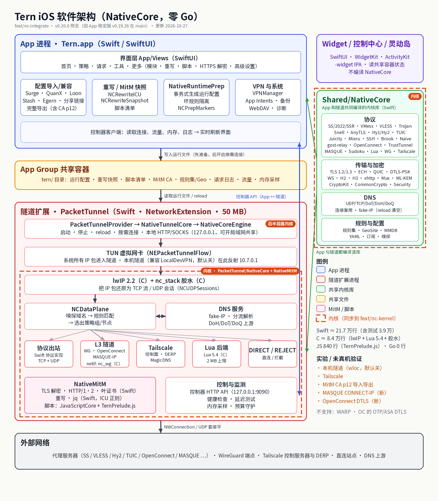
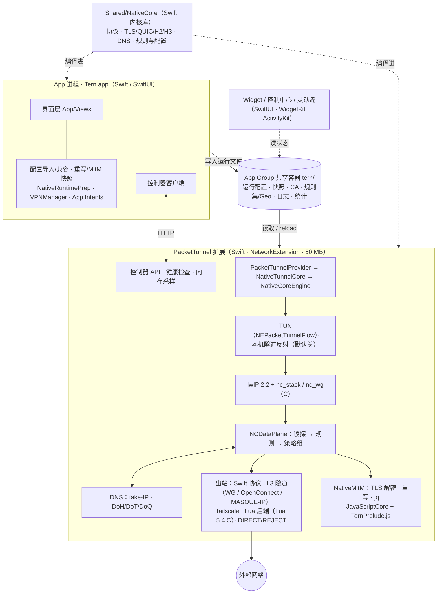

# Tern（NativeCore 原生内核的 iOS 代理客户端）

Tern 是一个**全新的 App**：Bundle ID `com.astemo6.tern`（`.tunnel` / `.widget`）、App Group `group.com.astemo6.tern`、URL scheme `tern://`。内核是自研 **NativeCore**——纯 Swift 数据面 + 内嵌 lwIP（C）与 nc_wg / nc_stack 胶水（C）+ JavaScriptCore 脚本，**零 Go**；协议 / 规则 / DNS 语义对标 [Clash.Meta](https://github.com/MetaCubeX/mihomo) 与 Surge / Loon / Quantumult X。

卡片界面（深色 / 浅色），五个标签页——首页、策略、请求、工具、更多；首页只放最常用的东西，功能页在「工具」，设置在「更多」，进阶选项收在「更多 → 高级设置」。

> 本项目以 **GPL-3.0** 发布（见 `LICENSE` 与 `NOTICE`）。仓库里没有任何节点、证书或密钥。

> ⚠️ **旧 App 的备份无法导入。** Tern 与旧 App（`main` 分支，v0.19.26）可以同时安装，但不读取旧 App 的数据：请在 Tern 里重新导入订阅 / 配置链接，重新添加小组件与控制中心开关，使用 MitM 时重新安装并信任 CA。备份与恢复、WebDAV、同步文件夹、完整导出只认 Tern 自己写的文件。

## 分支

| 分支 | 内容 |
| --- | --- |
| `main` | 旧 App（Go 内核）稳定版 **v0.19.26**，不再改动 |
| `feat/nc-integrate` | **新 App Tern**（本分支），v0.20.0 预览版从这里发布 |
| `feat/nc-kernel` | 只同步 NativeCore 内核目录（`Shared/NativeCore`、`PacketTunnel/NativeCore`、`PacketTunnel/NativeMitM`），每次发布后同步 |
| `archive/go-kernel-v0.19.26` | Go 内核版本的归档 |

## 设计原则

1. **一个内部模型**：任何来源格式（Clash.Meta YAML、Surge / Quantumult X / Loon / Stash / Egern 的 .conf 与模块）只在导入边缘翻译一次为规范模型（见 `docs/native-config-model.md`），引擎只消费规范模型，不存在第二套运行逻辑；覆写 / 模块存储是我们自己的。
2. **一种设计语言**：项目自己的深色卡片（`Theme` / `Card`），新页面不照搬其他客户端的布局。
3. **首页极简**：连接开关、出站模式、IP 卡片、流量和可选的首页面板；功能页在「工具」，设置与进阶项在「更多」。
4. **模块只有一个入口**：所有格式的模块和远程资源（规则集、脚本）都在「工具 → 模块」，用角标标出来源格式。
5. **内存优先**：隧道扩展预算 50 MB，新功能先按内存选方案；做不精的功能先不做或明确标为不可用。
6. **规则、重写、脚本都接受 Surge 与 Quantumult X 写法**（以及 Loon、Stash、Egern），只在边缘翻译一次。

## 功能概览

- **导入**：Surge / Quantumult X / Loon / Stash / Egern 的配置、模块、插件、覆写，Clash.Meta YAML、订阅与分享链接，全部归一为同一份规范模型；`.conf` 导入先显示转换报告。
- **重写 / 脚本 / MitM / 模块**：URL / 头部 / 内容 / jq 重写、本地映射、JS 脚本（Surge / QX / Loon / Egern API）、HTTPS 解密，模块库与策略映射。
- **完整导出**：QuanX 风格的单文件导出，含节点、规则、重写、模块、MitM 主机名与 **CA（带口令的 p12）**，以及 `[tern_data]` 里的 Tern 设置；可在另一台设备上完整恢复。
- QX `filter_remote` 与 QX 一致：没写 `force-policy` 时按列表内每行自己的策略分流，配置里没有的策略会自动建成手动选择组（单个列表最多拆 32 个策略）；列表第一次下载并拆分完成之前，整份列表走第一个手动选择组。导入的配置与自定义规则、「资源」手动刷新都按这一方式处理。

| 位置 | 内容 |
| --- | --- |
| 首页 | 连接开关、规则 / 全局 / 直连、IP / ASN 卡片（出口 + 直连，副标题可选）、当前配置与节点、实时速度曲线、本次上传 / 下载（全部流量或仅代理流量）；**首页面板**（内置卡片：网速、流量、连接时长、出口 IP、内网 IP、内存、解锁结果；模块 `[Panel]` / Stash `tiles` 与脚本任务也可固定；长按卡片直接拖动排序（半宽 / 全宽），也可在「编辑首页面板」里排序；长按菜单「从首页移除」会先确认）；分析卡片（策略 / 规则 / 主机名，可选） |
| 策略 | 已连接：实时策略组、点选切换、组测速；长按策略组：测速、置顶、换图标、编辑；拖动或「编辑排序」调整策略组顺序；自动 / 故障转移组可开「智能选择」；任意策略组可设**前置代理**并显示策略链。**未连接：「未连接 · 来自配置文件」离线策略页**——读取当前配置（含节点集缓存、合并的手动节点），可以选节点（按配置保存，下次连接时自动应用）、直接测速 |
| 请求 | 实时连接、最近关闭、MitM 解密的 HTTP 请求（头部 / 内容查看、**复制为 cURL、重放、编辑后重放**、导出 HAR）、请求时间线 |
| 工具 → 节点与订阅 | 配置订阅与节点订阅分开管理：流量 / 到期（`subscription-userinfo`）、左右滑（更新、复制链接）、长按（编辑、停用、图标、节点处理、删除）；全部节点、手动节点（添加 / 编辑 / 分享 / 凭据查看）、节点集（停用 / 删除 / 编辑）、筛选节点（按地区 / 关键词生成策略组）、离线测速 |
| 工具 → 分流规则 | 规则（实时或离线，命中计数）+ **自定义规则**（Surge / QX / Loon / Clash.Meta 写法，表单或文本模式，实时校验并显示转换结果与策略组；远程 RULE-SET / DOMAIN-SET / QX filter_remote；拖动排序） |
| 工具 → 模块 / 重写 / 脚本 / 定时任务 / HTTPS 解密 | **模块**（全部格式一个入口，格式角标；远程规则集 / 重写集 / 脚本各自的更新间隔、开关、错误、全部更新；一键添加 BoxJS；**模块库**浏览 / 搜索 / 预览；Loon `[Argument]` 参数；**策略映射**）、**本地模块**（重写规则 + MitM 主机名：表单编辑、拖动排序、文本模式）、**脚本调试台**、定时（cron）与通用脚本任务、HTTPS 解密（CA 证书、主机名、QUIC 选项） |
| 工具 → DNS / 日志 / 网络 | DNS（国内 / 国外分流、引导 DNS、nameserver-policy、Fake-IP 过滤、本地映射）、运行日志、DNS 日志、连接分析（按天保存）、网络工具（Ping / TCP / DNS，经过内核规则并显示策略链）、网速测试（带宽 / NAT 类型）、**解锁检测**（按策略 / 节点）、内网 IP 与路由器 |
| 更多 | 配置（**配置编辑器**：YAML 高亮、内核实时校验并标出错误行列；订阅配置只读，可「复制为本地配置」；**节点处理**：过滤、重命名、旗帜、去重、排序 + 实时预览；**覆写脚本**；订阅 / 本地 YAML / 剪贴板 / 文件；**Surge / Quantumult X / Loon / Clash `.conf` 导入**先显示转换报告）、流量统计（Swift Charts，按天保存约 120 天）、配置快照、**备份与恢复**（文件 / 分享 / iCloud、WebDAV 多版本可加密、iCloud 云盘同步文件夹；底部「清除全部数据」：VPN 配置、App Group、偏好、钥匙串、缓存全部清除后退出；删除重装后若 App Group 里还有上次的配置，启动时询问保留或全部清除）、更新资源、存储空间、深色与浅色、App 图标、开始标签页、首页流量统计范围、新手引导、诊断与反馈（**一键导出诊断包**、App Group 与候选组、扩展 ID、启动日志、隧道内存）、关于 |
| 更多 → 高级设置 | 连接方式（全局隧道 / 混合 / 仅代理、路由、跳过代理、阻止 QUIC、阻止 WebRTC、IPv6、**局域网共享**与多用户、按需连接：始终 / 仅 Wi-Fi / 仅蜂窝，App 内手动断开会暂停按需连接；**本机隧道**（兼容 LocalDevVPN，实验性，默认关））、隧道（包含所有网络 / 本地网络 / APNs / 蜂窝网络服务 / 设备通信、兼容性增强模式、FaceTime 走代理）、地理数据库（GeoIP MMDB、GEOIP dat、GEOSITE、GeoLite2-ASN：状态、默认 / 自定义地址、国内镜像、下载进度与错误）、内核设置（内存上限、隧道 MTU、手动节点合并进每个配置、日志、控制器、切换节点时断开连接、网络变化时清空 DNS 缓存）、测速设置、出口信息来源 |
| 快捷指令 | 连接、断开、切换连接、切换出站模式、切换节点、**查询状态、切换配置、开关模块、更新订阅、运行脚本**（App Intents）；主屏幕长按图标：连接 / 断开、规则 / 全局 / 直连 |
| 导入链接 | 只注册自己的 `tern://`（`tern://install-config?url=`、`install-module?url=`、`connect`、`disconnect`、`toggle`）。粘贴的 `loon://`、`stash://`、`surge:///`、`quantumult-x:///`、`egern:/` 安装链接也能识别，但**不注册**这些 scheme，避免与其他客户端抢链接。可以用「文件」/其他 App 的「用 Tern 打开」打开 `.sgmodule` `.plugin` `.stoverride` `.module` `.snippet` `.conf` `.list` `.yaml` 和纯文本 |
| 小组件 / 实时活动（`-widget` IPA） | 主屏幕 / 锁屏小组件、控制中心开关、灵动岛与锁屏实时活动（速度、节点、累计流量） |
| iPad | 横向宽度为常规时用侧边栏（NavigationSplitView）显示五个分区，支持横竖屏与分屏；iPhone 保持底部标签栏 |

## 更新日志

各版本改动见 [CHANGELOG.md](CHANGELOG.md)，安装包见 [GitHub Releases](https://github.com/astemo6/mihomo-ios/releases)。

## 软件架构

三个进程（App、PacketTunnel 隧道扩展、可选的 Widget 扩展）通过 **App Group 共享容器**交换文件，App 与隧道之间用**控制器 HTTP API**（127.0.0.1:9090）通信。`Shared/NativeCore` 由 App 和隧道各自编译（App 用它导入、校验、离线解析配置；隧道用它跑协议与规则），Widget 不编译内核。虚线框（`Shared/NativeCore`、`PacketTunnel/NativeCore`、`PacketTunnel/NativeMitM`）是内核，会同步到 `feat/nc-kernel`。

| 层 | 职责 | 语言/框架 | 目录 |
| --- | --- | --- | --- |
| App 界面 | 五个标签页、编辑器、诊断、iPad 侧边栏 | Swift · SwiftUI · Swift Charts | `App/Views/`、`App/TernApp.swift` |
| App 逻辑 | 导入器、运行配置生成（NativeRuntimePrep）、订阅、备份 / WebDAV、完整导出、VPNManager、App Intents | Swift · NetworkExtension（`NETunnelProviderManager`）· AppIntents | `App/Core/` |
| Widget / 控制中心 / 实时活动 | 小组件、控制中心开关、灵动岛与锁屏实时活动（`-widget` IPA） | Swift · SwiftUI · WidgetKit · ActivityKit · AppIntents | `Widget/`、`Shared/WidgetShared.swift`、`Shared/LiveActivity*.swift`、`Shared/TunnelControl.swift` |
| App ↔ 隧道 / 共享存储 | App Group 容器文件（`tern/`）、设置模型、钥匙串、请求日志、流量记录；控制器 HTTP API 客户端 | Swift · Foundation · Security | `Shared/*.swift`、`App/Core/ControllerClient.swift` |
| 隧道扩展 | 启停、reload、按需连接、网络设置（路由 / DNS / MTU / 本机隧道）、本地 HTTP/SOCKS | Swift · NetworkExtension（`NEPacketTunnelProvider`） | `PacketTunnel/PacketTunnelProvider.swift`、`PacketTunnel/NativeCore/NativeTunnelCore.swift`、`NativeCoreEngine.swift` |
| NativeCore 数据面 | packetFlow ⇄ lwIP、TCP / UDP 会话、UDP 出站会话、L3 隧道 netif、控制器、健康检查、内存采样 | Swift · Network.framework | `PacketTunnel/NativeCore/` |
| NativeCore 共享库 | 出站协议、TLS 1.2/1.3 / ECH / QUIC / H2 / H3 / DTLS-PSK、DNS / fake-IP、规则 / 规则集 / Geo、策略组、配置模型与导入器 | Swift · CryptoKit · CommonCrypto · Security | `Shared/NativeCore/` |
| TCP/IP 协议栈 | 把 IP 包还原为 TCP 流 / UDP 会话；WireGuard / OpenConnect / MASQUE-IP 的独立 netif | C（lwIP 2.2，BSD-3）+ C 胶水 `nc_stack.c` / `nc_wg.c`，经 `NCBridge.h` 桥接 | `PacketTunnel/NativeCore/lwip/` |
| Lua 自定义后端 | Shadowrocket 风格 Lua 后端，2 MB 内存上限 + 执行时限 | C（精简 Lua 5.4.6，MIT）+ Swift 驱动 | `PacketTunnel/NativeCore/Lua/`、`Shared/NativeCore/NCLua*.swift` |
| MitM / 重写 | TLS 终止、叶证书签发、HTTP/1.1 / HTTP/2、URL / 头部 / 内容 / jq 重写、请求记录 | Swift（正则用 ICU） | `PacketTunnel/NativeMitM/` |
| 脚本引擎 | Surge / QX / Loon / Egern 脚本 API、定时与事件任务 | JavaScript（JavaScriptCore 执行，`TernPrelude.js` 提供 API）+ Swift 调度 | `PacketTunnel/JSCScriptEngine.swift`、`PacketTunnel/NativeMitM/Script/` |
| 测试 | 单元测试、协议回环、UI（zh / en）、E2E 回放 | XCTest（Swift） | `UnitTests/`、`AppTests/`、`UITests/`、`E2ETests/` |
| CI 工具 | 术语审计、IPA 体积 / 图标检查、lwIP 栈主机测试、回环服务器、E2E 服务端 | Python · Shell · C；对端服务器在 runner 上下载或从源码构建（sing-box、ocserv、官方 Sudoku / TrustTunnel、connect-ip-go） | `scripts/`、`tools/`、`.github/workflows/` |

代码量（v0.20.0 预览，约数）：Swift ≈ 21.7 万行（其中测试 ≈ 3.9 万）、C ≈ 8.4 万行（lwIP ≈ 5.6 万、Lua 5.4 ≈ 2.7 万、胶水 ≈ 0.14 万）、JS 840 行（`TernPrelude.js`）、Go 0 行。

其他要点：

- 设置文件（App Group 容器 `tern/`）：`subscriptions.json`、`overrides.json`（内核覆写，解码容错，不含密钥）、`secrets.json`（控制器密钥与局域网共享密码，0600，只进加密备份）、`dns.json`、`rules.json`、`engine/`（MitM / 重写 / 脚本 / 模块）；每个配置旁的 `<id>.selected.json` 保存离线选择的节点。
- 工程由 XcodeGen 从 `project.yml` 生成；**Bundle ID 与 App Group 只在 `project.yml` 顶部改一处**。

## 协议支持

NativeCore 出站协议（尚未接入的节点保留在配置中、显示为不可用并在「诊断」里写明原因，清单以 `Shared/NativeCore/NCSupport.swift` 为准）：

| 协议 | 说明 |
| --- | --- |
| Shadowsocks / SS2022 / ShadowsocksR | 插件：obfs、v2ray-plugin、shadow-tls v1–3、gost-plugin、restls、cloak、kcptun |
| VMess / VLESS / Trojan | 传输 tcp / ws / grpc / h2 / http / xhttp；VLESS Reality、XTLS-Vision、mlkem768x25519plus encryption；ECH |
| Hysteria / Hysteria2 / TUIC v5 / Juicity | QUIC 系，TCP + UDP |
| Snell / AnyTLS / Mieru / SSH / Brook / gost-relay | — |
| NaïveProxy、HTTP/2 / HTTP/3 CONNECT 代理 | Shadowrocket 风格 h2 / h3 节点 |
| SOCKS5 / HTTP / HTTPS | — |
| WireGuard（含 AmneziaWG 1.0） | 独立 lwIP netif（nc_wg） |
| Tailscale | 控制面、DERP、MagicDNS；未经真机验证 |
| **OpenConnect**（新） | CSTP + **DTLS** 数据通道（DTLS 不通时回退 CSTP）、split-include / split-exclude 路由；不支持 OTP / 二次认证、ASA 旧式 DTLS |
| **Sudoku**（新） | 与官方服务端 TCP 互通（握手、双向密钥轮换、自定义表）；不支持 UDP、HTTP 隧道模式（stream / poll / auto / ws）与 `multiplex: on` |
| **TrustTunnel**（新） | HTTP/2 + **HTTP/3**，TCP + UDP；H3 连不上时回退 H2（`h2-fallback`，默认开） |
| **MASQUE**（新） | CONNECT-UDP + **CONNECT-IP**（RFC 9484，TCP + UDP）+ **Cloudflare WARP**（cf-connect-ip，客户端证书 mTLS + 服务端公钥固定）；WARP 配置需用外部工具生成（App 内不做注册） |
| **Lua 自定义后端**（新） | Shadowrocket 风格 Lua 后端（精简 Lua 5.4） |

**本机隧道（wloc，新，实验性）**：兼容 LocalDevVPN，把发往 `10.7.0.1`（可改）的包在隧道内反射回本机，供 wloc、StikDebug、SideStore 等工具使用，不经过规则与统计。默认关闭，入口「更多 → 高级设置 → 连接方式 → 本机隧道」，改后需重新连接；尚未经过真机验证。

导入解析（App 侧 Swift 导入器）：分享链接（`ss://` `ssr://` `vmess://` `vless://` `trojan://` `hysteria(2)://` `hy2://` `tuic://` `wireguard://` `snell://` `anytls://` `mierus://` `socks5://` `http(s)://` 等）、base64 订阅、Clash.Meta / Clash YAML、Surge / Egern、Quantumult X、Loon、Stash。策略页每个节点都有协议角标。

## 重写 / MitM / 脚本 / 模块

入口：工具 → 模块 / 重写 / 脚本 / HTTPS 解密（v0.7 起「重写」即「本地模块」，可用表单编辑）。这些页面共用一个「启用重写与脚本」总开关；HTTPS 解密另有独立开关。全部关闭时内核不会加载 HTTP 引擎，不额外占用内存。

### 工作方式

扩展内（Swift）运行一个本地 HTTP 引擎（127.0.0.1 随机端口）。开启后，启动内核前会向配置注入：

- 出站 `__MITM__`（`type: http` 指向本地引擎，策略页已隐藏）；
- 内联规则集 `__mitm_hosts` / `__mitm_skip`（由 MitM 主机名生成）；
- 置顶规则：MitM 主机的 UDP 443（QUIC）直接拒绝，让 App 回落到 TCP；MitM 主机的 TCP 443（或 `host:port` 指定的端口）交给引擎；有 HTTP 规则时所有 TCP 80 交给引擎；模块里的 REJECT / DIRECT 规则。

引擎解密后按规则处理请求，再通过内核的 inner 通道发出，**仍然按你原来的规则和策略组走代理**（不会因为 MitM 变成直连）。客户端支持 HTTP/1.1 与 HTTP/2（可关），WebSocket 透传。握手失败（证书固定 / 未信任 CA）的主机会自动放行 30 分钟并在日志中提示。注意：全局 / 直连模式下不使用规则，MitM 不生效。

### 安装并信任证书（手机上操作）

1. 工具 → HTTPS 解密 → 生成 CA 证书（ECDSA P-256，10 年；私钥只保存在本机 App Group 容器的 `tern/engine/ca/`，不进钥匙串、不上传、不在仓库里）。
2. 点「安装证书（通过 Safari）」，在 Safari 弹窗中选「允许」下载描述文件；也可以用「分享 / 存储描述文件」存到“文件”App 后点开。
3. 设置 → 已下载描述文件（或 通用 → VPN 与设备管理）→ 安装。
4. 设置 → 通用 → 关于本机 → **证书信任设置** → 打开「Tern MitM CA xxxxxx」的完全信任。
5. 回到 HTTPS 解密页，状态显示「已安装并完全信任」后打开「HTTPS 解密」，添加主机名（或启用带 hostname 的模块）。

可导出 `.cer`、或带密码的 `.p12`（含私钥，用于备份 / 迁移，也可从 p12 导入）。「重新生成证书」后需要重新安装并信任。

### 支持的语法

| 类别 | 支持 |
| --- | --- |
| MitM 主机名 | `hostname = %APPEND% a.com, *.b.com, -c.b.com, d.com:8443`（`*`/`?` 通配、`-` 排除、`:端口`），Surge `skip-server-cert-verify`、`h2` |
| Surge [URL Rewrite] | `正则 替换 302/307/header`，`正则 - reject / reject-200 / reject-img / reject-dict / reject-array / reject-drop`（`reject-tinygif`、`reject-no-drop`、`reject-video` 视为等价项） |
| Surge [Header Rewrite] | `正则 header-add/header-del/header-replace/header-replace-regex …`，以及 `http-request` / `http-response` 前缀的新写法 |
| Surge [Body Rewrite] | `http-request\|http-response 正则 查找1 替换1 查找2 替换2 …`、`http-response-jq 正则 'jq 表达式'`（Swift 实现的 jq 子集，支持 `jq-path=`） |
| Surge [Map Local] | `正则 data="…" data-type=text\|base64\|tiny-gif\|json\|file header="A:b\|C:d" status-code=200`（data 可为 URL / 本地文件 / 内联文本） |
| Surge [Script] | `名称 = type=http-request\|http-response,pattern=…,requires-body=1,max-size=…,binary-body-mode=1,script-path=URL或本地文件,argument=…,timeout=…,script-update-interval=…` |
| Surge [Rule]（模块） | `DOMAIN / DOMAIN-SUFFIX / DOMAIN-KEYWORD / DOMAIN-WILDCARD / IP-CIDR(6) / GEOIP / IP-ASN / DST-PORT`，仅 REJECT* / DIRECT 策略；`URL-REGEX,…,REJECT*` 转为 URL 重写 |
| Surge 模块 | `#!name`、`#!desc`、`#!arguments=键:默认值,…` + `{{{键}}}` 替换（可在模块详情里改参数）、`#!arguments-desc` |
| Quantumult X | `正则 url reject/reject-200/reject-img/reject-dict/reject-array/302/307`、`request-header`/`response-header`（整段头部正则）、`request-body`/`response-body`、`script-request-header/-body`、`script-response-header/-body`、`script-echo-response`、`script-analyze-echo-response`、`echo-response`；`[rewrite_local]`、`[mitm]`、`[filter_local]`（host/host-suffix/host-keyword/ip-cidr 的 reject/direct）及无分段的重写片段 |
| Loon 插件 | `[Rewrite]` 的 `正则 reject*/302/307 目标`、`header-*`、`response-body-json-del/replace/add`、`response-body-replace-regex`、`mock-response-body`；`[Script]` 的 `http-request\|http-response 正则 script-path=…, requires-body=true, tag=…, argument=…` |
| Stash 覆写 | `http.mitm`、`http.rewrite` / `url-rewrite` / `header-rewrite` / `body-rewrite`、`http.script` + `script-providers` |

正则使用 ICU 引擎（兼容 JavaScript 写法，支持前后向断言），匹配完整 URL。URL 重写与本地映射首条命中生效；头部、内容和脚本按顺序全部执行。需要处理内容时会把上游编码限制为 gzip/deflate/br 并自动解压。

### 脚本 API（JavaScriptCore 引擎，支持 async/await）

- Surge：`$request`（url、method、headers 大小写不敏感、body）、`$response`（status、headers、body）、`$done()`（请求阶段可改 url/method/headers/body，或 `{response:{status,headers,body}}` 直接返回；响应阶段可改 status/headers/body）、`$httpClient.get/post/put/delete/head/options/patch`（经内核发出，支持 `policy`、`binary-mode`、`insecure`、`auto-redirect`、`timeout`）、`$persistentStore.read/write`（存于 App Group，可在 脚本 → 持久化存储 查看编辑）、`$notification.post`（由扩展发本地通知，需在脚本页允许通知）、`$script`、`$environment`（声明为 Surge）、`$argument`、`console.*`、`setTimeout/setInterval`。
- Quantumult X：`$task.fetch`（Promise，支持 `opts.policy`）、`$prefs.valueForKey/setValueForKey/removeValueForKey/removeAllValues`、`$notify`，`$done({status:"HTTP/1.1 200 OK", …})`、`bodyBytes`。
- 二进制：`binary-body-mode` 时 body 为 `Uint8Array`（并提供 `bodyBytes`），`$done` 接受字符串 / Uint8Array / ArrayBuffer；另有 `TextEncoder`/`TextDecoder`、`atob`/`btoa`。
- 资源限制：每次执行使用独立运行时（编译结果缓存 16 个），同时最多 2 个脚本，默认超时 10 秒（超时则保持原样），需要 body 的规则缓冲上限 2 MB（`max-size` 可更小）。远程脚本经内核下载并缓存，按 `script-update-interval`（默认 1 天）后台更新。
- 定时 / 事件 / 通用脚本、`$utils`、面板见「v0.4 要点」；Egern 模块与 `$httpAPI` 见「v0.5 要点」。Surge `type=dns` / `type=rule` 脚本：在隧道内执行（契约与实现见 `PacketTunnel/NativeCore/NCScriptHookRunner.swift`，出错时放行）。Egern 原生 `ctx` 脚本见「v0.6 要点」。

## 开发流程

1. **分支**：`main` 是旧 Go 版稳定线，不动；`feat/nc-integrate` 是集成分支，只由维护者合并 / 快进；`feat/nc-kernel` 只放内核，发布后同步。每个题目一条 lane：从 `feat/nc-integrate` 最新提交拉 `fix/nc-<题目>` 或 `feat/nc-<题目>`，一条 lane 只做一个题目。
2. **提交**：作者 zhihenglu；lane 提交带 `[skip ci]`；每次提交后都推送 lane 分支到 origin。
3. **CI 就是编译器**：本地没有 Swift 编译器。验证时把同一提交推到 `test/*` 引用再手动触发 workflow；runner 不够时用公开的 CI 镜像仓库加跑，镜像上只推 `test/*` 引用，最终代码和发布只在本仓库。
4. **按改动跑测试**（见下表）；同一问题最多 3 轮 CI 迭代，仍不过就停下报告。
5. **协议上线标准**：只有对真实服务端的回环测试通过后，才在 `NCSupport` 里放开；做不到的节点显示为不可用并写明原因，不静默失败。
6. **零 Go、无多余上游名**：仓库不含任何 `.go` 源文件（Go 工具链只在 CI 里构建回环测试的对端服务器）；`scripts/term_audit.py` 检查全仓库的旧名残留与界面术语一致性，必须为 0。
7. **合并顺序**：各 lane 绿 → 合成一个候选头 → 在候选头上跑最终门禁 → 快进 `feat/nc-integrate` → 预发布（`ios.yml` 只从 `main` / `feat/nc-integrate` 发布）→ 同步内核到 `feat/nc-kernel`。稳定版发布和任何改动 `main` 的操作都需要所有者批准。

| 层级 | 何时 | 跑什么 |
| --- | --- | --- |
| 单次改动（lane） | 每条 lane | Checks（术语审计 + lwIP 栈主机测试）+ IPA `build_only` + 受影响的测试：相关单元测试（`only=`）、该协议的 proto-loopback、相关 UI 测试 |
| 小迭代发布 | 改动小、未碰数据面 / lwIP / DNS / 配置生成 / 存储 | Checks + 构建 + 受影响的测试 + E2E 回放（对比上一个全绿的发布头） |
| 发布头（完整） | 大批量，或改到上述核心部分 | Checks、构建、全部 `TernUnitTests`、proto-loopback（真实服务端）、UI 全量 zh + en、E2E 回放（真实配置 + 内存门禁） |

## 测试与 CI

- **单元测试** `TernUnitTests`（`UnitTests/`、`AppTests/`）：协议编解码、导入器、规则、DNS、重写、脚本、完整导出等。
- **协议回环** `proto-loopback.yml`：在 macOS runner 上起真实服务端——sing-box、官方 TrustTunnel endpoint、官方 Sudoku 服务端（从源码构建）、MASQUE 对端；OpenConnect（ocserv）与 MASQUE CONNECT-IP（connect-ip-go）跑在 QEMU 里的 Alpine 虚拟机中——由模拟器里的 NativeCore 实际拨号收发数据；可选作业 `masque-warp` 临时注册一个免费 WARP 设备，连接 Cloudflare 真实端点验证后注销。
- **UI 测试** `ui-tests.yml`（Self-test）：模拟器 UI 测试，zh-Hans 与 en、浅色与深色；按改动自动选冒烟或完整矩阵，提交信息可用 `[shard:all|smoke|full]`、`[only:<测试>]`、`[unit:<类>]`、`[skip-ui]`。
- **E2E 回放** `e2e-replay.yml`：用加密的真实配置（需要仓库 secret）回放启动、规则、DNS、MitM、脚本、重启与 reload，并按内核峰值内存判定内存门禁。
- **Checks** `checks.yml`：`scripts/term_audit.py` 与 `tools/nc-stack-test`（lwIP 栈 C 代码的主机测试 + 压测）。
- **打包** `ios.yml`：XcodeGen 生成工程 → `xcodebuild archive` → IPA；手动运行可勾 `build_only` 只编译。打包后 `scripts/ipa_size.py` 检查 IPA 不夹带内嵌 framework / dSYM / 头文件（内核编译进 App 与扩展，不链接任何静态内核库），`scripts/icon_check.py` 检查图标。没有签名 secrets 时伪签名输出 `Tern-<版本>-build<N>-widget-unsigned.ipa`（附 entitlements）；有 secrets 时输出 `-signed.ipa`。

触发与去重的现行规则见 `CI.md`。

## 获取可安装的签名版本

需要付费的 Apple Developer 账号（个人免费账号无法使用 Network Extension 能力）。

1. **注册 App ID**（Certificates, Identifiers & Profiles → Identifiers → +，App IDs）：
   - `com.astemo6.tern`：勾选 **App Groups** 和 **Network Extensions**。
   - `com.astemo6.tern.tunnel`：同样勾选 **App Groups** 和 **Network Extensions**。
   - 如果用自己的前缀，改 `project.yml` 顶部的 `APP_BUNDLE_ID` / `TUNNEL_BUNDLE_ID` / `APP_GROUP_ID`。
2. **注册 App Group**：Identifiers → 右上角切到 App Groups → +，`group.com.astemo6.tern`。然后回到两个 App ID，在 App Groups 能力里 Configure，勾选这个组。
3. **证书**：Apple Development（development 方式）或 Apple Distribution（ad-hoc 方式）。在钥匙串里导出为 `.p12`（带密码）。
4. **注册设备**（Devices → +，填 iPhone 的 UDID）。
5. **描述文件**（Profiles → +）：类型选 iOS App Development（或 Ad Hoc），分别给两个 App ID 各建一个，选上证书和设备，下载两个 `.mobileprovision`。
6. **添加仓库 Secrets**（Settings → Secrets and variables → Actions → New repository secret）：

   | Secret | 值 |
   | --- | --- |
   | `BUILD_CERTIFICATE_BASE64` | `base64 -i cert.p12 \| pbcopy` 的结果 |
   | `P12_PASSWORD` | 导出 p12 时设的密码 |
   | `APP_PROFILE_BASE64` | 主 App 描述文件的 base64 |
   | `TUNNEL_PROFILE_BASE64` | 扩展描述文件的 base64 |
   | `TEAM_ID` | 10 位 Team ID（Membership 页面） |
   | `KEYCHAIN_PASSWORD` | 任意随机字符串（CI 临时钥匙串用） |
   | `EXPORT_METHOD` | 可选：`development`（默认）或 `ad-hoc` |

7. Actions → iOS IPA → Run workflow。完成后在 Releases 下载 `*-signed.ipa`，用 Apple Configurator、Xcode（Devices 窗口拖入）或 `ideviceinstaller` 安装。

### 不配 secrets，直接自签

下载 `*-unsigned.ipa`，用 Sideloadly / ESign / 爱思等工具，配合**开启了 Network Extension + App Groups 能力**的证书和描述文件重签。注意：

- 两个 target 都必须带 `com.apple.developer.networking.networkextension = [packet-tunnel-provider]` 和 `com.apple.security.application-groups`；
- App Group 在运行时自动解析：App、扩展和小组件各自读取包内 `embedded.mobileprovision` 中的 `com.apple.security.application-groups`；第一次按字母序取第一个系统认可的组（都不可用时再回退到 Info.plist 中的值和 `group.com.astemo6.tern`）并记住，之后优先用记住的组，其次是已有配置的组，描述文件续期后组列表变了也不会换到空容器，所以保持原 Bundle ID、用任意第三方购买的描述文件重签也能共享配置；隧道扩展 ID 从包内 PlugIns 的 packet-tunnel 扩展读取（回退为 `主程序 ID + .tunnel`），已保存的旧 VPN 配置会自动改指向新 ID；
- 连接失败时首页会弹窗显示原因；更多 → 诊断与反馈 显示解析出的 App Group、候选组、扩展 ID 和共享容器是否可用，组可能不对时会给出提示；
- 免费 Apple ID 证书不包含 Network Extension 能力，连接会失败。

## 使用

1. 「工具 → 节点与订阅」→ + → 添加配置订阅（或在「更多 → 配置」从剪贴板 / 文件导入），保存时会用内核校验。
2. 「首页」打开开关，首次会弹出“添加 VPN 配置”系统提示，允许即可。
3. 「策略」里切换节点；首页会自动刷新出口 IP 与 ASN。

## 已知限制

- 网络扩展内存上限约 50 MB。大型 `GEOSITE` 规则、超大订阅或大量规则集会增加内存，建议优先使用 `.mrs` 规则集。
- 仅代理模式：不遵守系统代理的 App 与所有 UDP / QUIC 会直连；按 IP 的规则与 Fake-IP 不生效。
- iCloud 备份需要签名里有 iCloud 容器权限；没有时可在「保存到文件」时选 iCloud 云盘。
- MitM：HTTP/3（QUIC）无法解密，默认对 MitM 主机阻断 UDP 443（可按主机放行，或选择全部阻断）；证书固定的 App 会握手失败并被自动放行。
- 协议缺口见「协议支持」：OpenConnect 无 OTP / ASA DTLS，Sudoku 无 UDP；TrustTunnel H3 不通时第一个连接最多等约 15 秒才回退 H2。
- 本机隧道、Tailscale、MitM CA p12 尚未经过真机验证。
- `socks5` 节点 `tls=true` 目前仍按明文连接（#168）；AnyTLS 节点主机名超过 255 字节会导致隧道崩溃（#170）。
- 喜马拉雅解锁脚本在 NativeCore 下尚未经过真机验证；WARP 注册与 Sudoku UDP 已有内核实现，但尚未接入 App 界面（#166 / #167）。

## 许可与致谢

GPL-3.0，详见 `LICENSE`、`NOTICE` 与 App 内 更多 → 关于。

- [mihomo](https://github.com/MetaCubeX/mihomo)（Clash.Meta，MetaCubeX，GPL-3.0）：NativeCore 协议、规则与配置语义的参考（用 Swift 独立实现，不链接上游代码）。
- [TokenPLS/Hako](https://github.com/ProjectClash/Clash-Legacy) 与 [Hako-Adapter](https://github.com/ProjectClash/Clash-Adapter-Legacy)（现由 [ProjectClash](https://github.com/ProjectClash) 维护，GPL-3.0）：NetworkExtension 内存控制与早期包流桥接的设计参考。
- [lwIP](https://savannah.nongnu.org/projects/lwip/) 2.2（BSD-3-Clause），内嵌于 `PacketTunnel/NativeCore/lwip/`。
- [Lua](https://www.lua.org/) 5.4.6（MIT），精简后内嵌于 `PacketTunnel/NativeCore/Lua/`。
- [MetaCubeX/meta-rules-dat](https://github.com/MetaCubeX/meta-rules-dat)：内置 GeoIP / GeoSite / ASN 数据；GeoLite2-ASN 数据由 MaxMind 提供。
- 系统 JavaScriptCore（脚本引擎）与 ICU（正则）。
